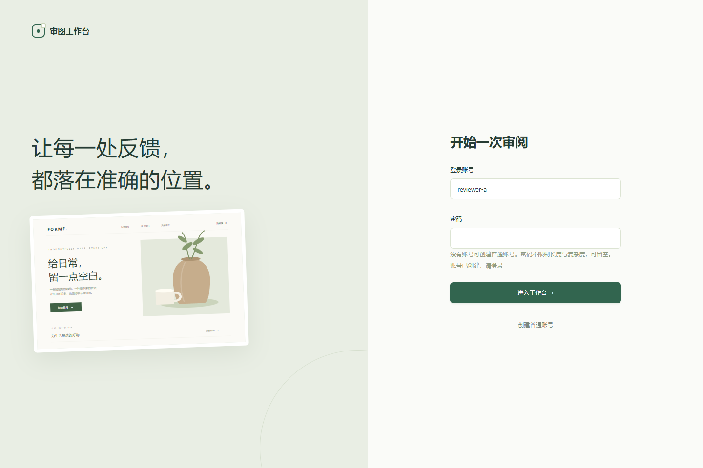
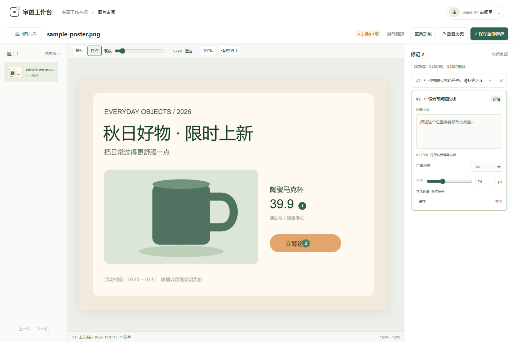
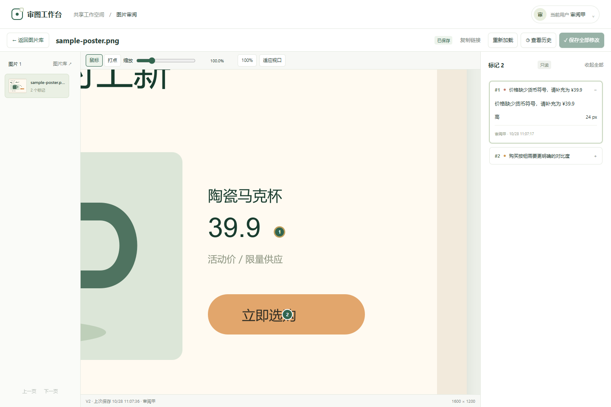
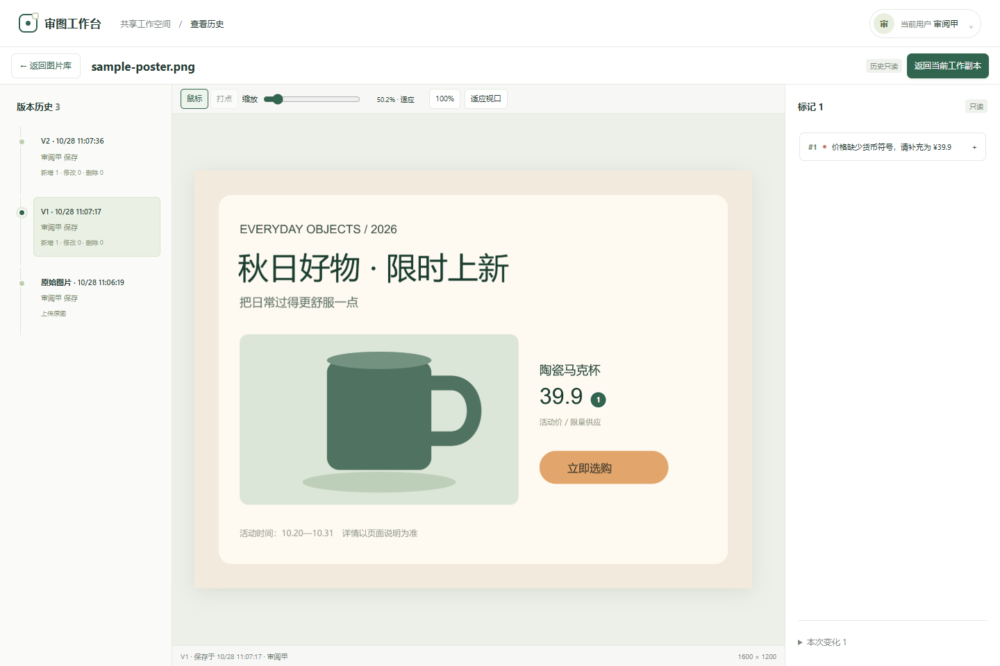
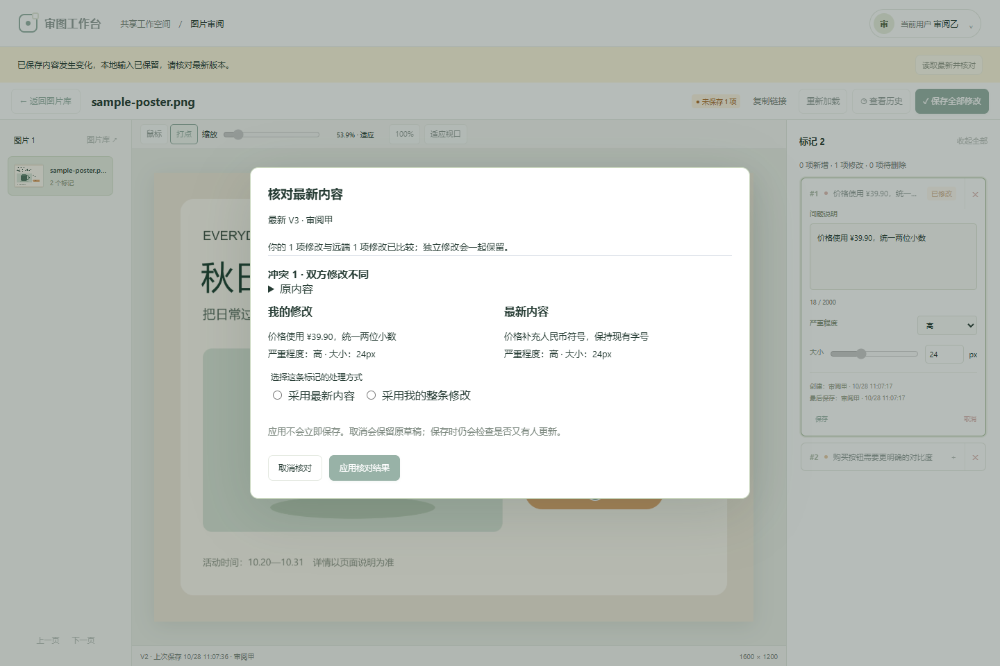
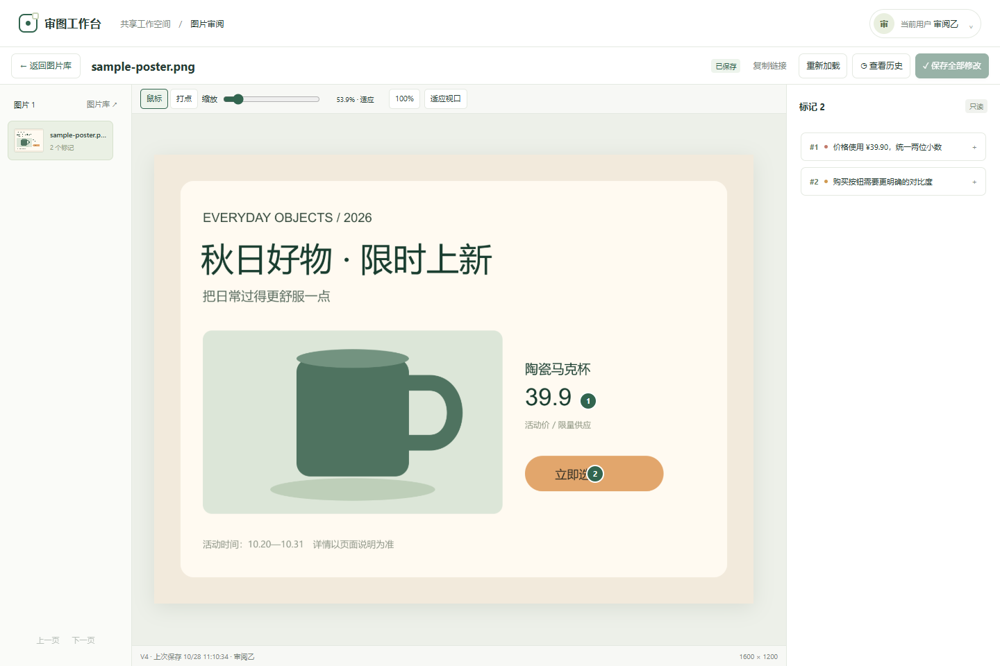
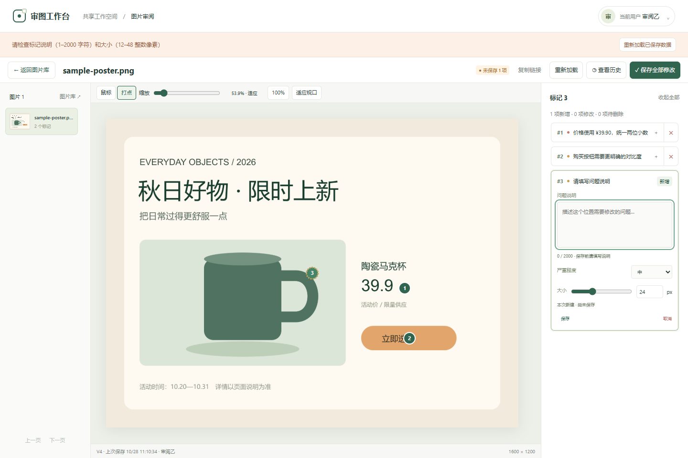

# 审图打点 · 提交说明

仓库：[ming-lah/image-review-annotator](https://github.com/ming-lah/image-review-annotator)  
技术栈：Vue 3 + TypeScript / Node.js + TypeScript / 本地 SQLite  
更新：2026-10-28

这是一款本地运行的图片审阅工具：上传海报或商详图，在问题位置打点、填写说明并保存，同事再次打开同一张图时可以继续处理。本文集中说明需求、运行方法、设计、图文案例、失败复现和与AI的协作，按本文即可运行和体验。

- [需求与产品规则](#一需求与产品规则)
- [安装与运行](#二安装与运行)
- [图文操作案例](#三图文操作案例)
- [设计与关键取舍](#四设计与关键取舍)
- [可复现的失败](#五可复现的失败)
- [验证结果与验收](#六验证结果与验收)
- [与AI协作](#七我与ai怎样协作)
- [边界与后续](#八边界与后续)

## 一、需求与产品规则

### 我怎样补全题目

题目的核心是“点图写字后能保存并交接”，我补充了三个验收目标：视图改变后位置仍正确；保存范围和结果明确；多人修改不会静默覆盖。

| 需求 | 当前实现与规则 |
|---|---|
| 技术约束 | Vue 3 + TypeScript前端，Node/Express + TypeScript后端；业务数据存本地SQLite，原图存本机文件，不使用React或远程数据库 |
| 找图与上传 | 共享图库，搜索、排序、分页、网格/列表；一次选1–10张静态PNG/JPEG/WebP，逐张上传 |
| 图片限制 | 单张≤20MiB，各边≤12000px，总像素≤4000万；拒绝动画、损坏文件、声明与字节不一致及非正常EXIF方向 |
| 打点与说明 | 编号圆点，每图工作台最多编辑500条；说明去除首尾空白后1–2000字符，低/中/高严重程度，独立点大小12–48px |
| 浏览与编辑 | 默认鼠标模式：平移、滚轮缩放、只读查看；切换打点模式才新增和编辑。留白不能打点，选中已有点不新增 |
| 修改与删除 | 可改说明、严重程度、点大小，可删除或撤回待删除标记。已保存坐标不可拖动修改，位置不对时删后重建 |
| 保存语义 | 当前点“保存”只提交该点；“保存全部修改”提交整个有效集合，有无效说明时要求修正。切图、离开或退出前保护未保存输入 |
| 版本与交接 | 每次有效保存形成一个固定版本，记录操作人及增改删变化；历史只读。重开链接可读正式内容，同标签页另有尽力恢复的草稿 |
| 操作者 | 本地账号与服务端会话；成员可在页面注册，昵称可选。管理员在本机终端创建；没有默认管理员密码 |
| 权限与共享 | 成员共享查看、上传、增改删标记；管理员额外可删除整张图片。整图删除需确认，会清除原图、标记及全部历史，不可撤销 |
| 多人修改 | 保存检查整图版本，基线过期返回409；保留本地输入并提供三方核对。同一点冲突需要明确选择，再次保存仍检查版本 |
| 明确失败 | 配置、目录、迁移与端口错误明确失败，不静默换目录或端口；API返回稳定错误码、中文提示和requestId |

账号用于稳定识别操作者和限制整图删除；密码允许为空，不设复杂度要求，适用于默认本机访问的演示。没有组织、逐图权限或网页管理员控制台。

## 二、安装与运行

### 最短启动路径

需要 **Node.js 24.x**。下载或克隆仓库后，在根目录运行：

```bash
npm ci
npm run dev
```

访问 **http://127.0.0.1:5174**，点击“创建普通账号”，填写登录账号和密码，创建后返回登录页登录。密码可以留空。登录账号是1–40位小写字母、数字及点、横线、下划线，首位必须是字母或数字；输入中的大写会归一化。

然后上传任意合规图片，或直接选择仓库中的 **docs/assets/submission/sample-poster.png**，即可按下方案例操作。本文截图使用的就是这张样例海报，不需要下载额外演示包或使用作者留下的数据库。

生产方式：

```bash
npm run build
npm run start
```

生产页面为 **http://127.0.0.1:3002**，页面、API和原图由同一服务提供。只停止自己启动的实例；不要同时让开发后端与生产服务占用3002。

### 隔离体验数据与配置

不希望演示写入默认用户目录时，可在PowerShell中先设置：

```powershell
# 在仓库根目录执行；使用新的或自己确认可继续使用的目录
$env:DATA_DIR = Join-Path (Get-Location) 'tests/.tmp/submission-demo/data'
npm run dev
```

环境变量在当前终端后续命令中继续生效。结束自己的服务后，用`Remove-Item Env:DATA_DIR`恢复默认；这不会删除数据。

| 配置 | 默认值 / 规则 |
|---|---|
| HOST | 127.0.0.1，只监听本机 |
| PORT | 3002；显式覆盖时开发代理随之调整 |
| VITE_PORT | 5174；显式覆盖时使用对应页面地址 |
| DATA_DIR | 必须是绝对路径；默认Windows为%LOCALAPPDATA%/ImageReviewAnnotator，macOS为~/Library/Application Support/ImageReviewAnnotator，Linux为$XDG_DATA_HOME/ImageReviewAnnotator（未设则~/.local/share/ImageReviewAnnotator） |
| APP_ORIGIN | 可限定精确访问来源，不带末尾斜线；非本机监听要求显式HTTPS来源，TLS由部署方提供 |

需要体验整图删除时，在使用同一个`DATA_DIR`的终端创建管理员：

```bash
npm run account -- init admin "管理员"
```

按交互提示输入并确认密码，再用该账号登录。已有管理员时不重复初始化。维护命令还包括`create <login> <昵称>`、`reset <login>`、`disable <login>`、`enable <login>`、`role <login> admin|member`、`list`和`help`。密码通过隐藏输入读取，不写在命令参数中；最后一个有效管理员不能停用或降级。生产构建也可用`node dist/server/account-cli.js`执行同样命令。

可选的`npm run demo:prepare`会在`tests/.tmp/basic-demo/`生成16个合法/非法样本和带5条标记的固定数据。本文案例不依赖该包。使用它时将`DATA_DIR`设为该目录下的`data`，用`account reset t20000000-0000-4000-8000-000000000001`交互设置演示甲密码，演示乙为尾号002。已有包不会被prepare覆盖；`demo:reset`会放弃包内修改，只在确需重置且自己的实例已停止时执行。

## 三、图文操作案例

下面图片为 **2026-10-28实际页面截图**。示例通过Playwright驱动Edge 156 headless，在Windows、1440×960视口、生产构建、显式端口3302与独立测试数据库上执行。3302只用于本次隔离验证，项目默认端口仍是3002/5174。示例账号和海报均为测试材料。

### 案例1：新人从注册开始完成审图



1. 打开页面，点击“创建普通账号”。示例填写`reviewer-a`、昵称“审阅甲”，密码留空。
2. 提交后看到“账号已创建，请登录”，回到登录页面，账号已预填；注册本身不会自动替换已有登录会话。
3. 点击“进入工作台”，在图片库上传样例海报。
4. 单张上传成功后自动打开图片；默认处于鼠标模式，可浏览和缩放，尚未写入标记。

**结果与原因：** 本次注册、空密码登录和实际文件上传均完成。让新使用者直接从页面开始，不依赖维护人预先建普通账号。

### 案例2：只保存一个问题，其他草稿继续留着



1. 切到“打点”，在价格旁新增第一个点，填写“价格缺少货币符号，请补充为 ¥39.9”，严重程度选“高”。
2. 在购买按钮处新增第二个点，暂时不填说明。
3. 点击第一个点编辑区的“保存”，不是顶部“保存全部修改”。
4. 检查页面：左侧图片摘要只有 **1个正式标记**，右侧仍有第二个空草稿，顶部显示 **未保存1项**，底部版本为 **V1**。
5. 补齐第二个点“购买按钮需要更明确的对比度”，再点击顶部“保存全部修改”。


**结果与原因：** 单点保存后的HTTP读取确认正式集合只有1条、版本为V1；全部保存后为2条、V2。页面还保留草稿不代表草稿已经写入数据库，不能只用同标签页刷新判断保存范围。

### 案例3：放大后仍对准原位置，并能查看旧版



1. 在V2切换“鼠标”，点击“100%”，拖动或滚动查看局部。
2. 从右侧选择价格标记，让画布定位到该点，观察它仍对应价格问题。
3. 点击“查看历史”，选择V1，再点击“适应视口”。
4. 旧版只显示当时保存的价格问题；购买按钮的点是在V2新增，不能出现在V1，也不能直接修改历史。



**结果与原因：** 本次100%状态下，通过实际DOM测量计算标记中心与保存坐标投影的距离，误差小于 **0.001 CSS px**；旧版视图实际显示1条。这个数值只说明本次样例和视口的测量结果，不作为所有显示器缩放条件的保证。

### 案例4：两个人改同一点，明确核对后再保存



1. 用两个独立浏览器配置（例如普通窗口与独立隐私窗口）登录审阅甲、审阅乙，打开同一图片链接。两个普通标签页会共享Cookie，不适合作为两个独立账号。
2. 两边先从V2修改同一个价格点：甲填“价格补充人民币符号，保持现有字号”，乙填“价格使用 ¥39.90，统一两位小数”。两边都先留下草稿，再让甲保存为V3。
3. 乙收到“已保存内容发生变化，本地输入已保留”，点击“读取最新并核对”。
4. 核对窗口显示原内容、我的修改和最新内容；不选择时不能应用。本次选择“采用我的整条修改”，点击“应用核对结果”。
5. 应用只更新工作副本，尚未保存。再点击“保存全部修改”，刷新页面确认结果。



**结果与原因：** 本次刷新后的HTTP数据为 **V4、保存人审阅乙、2条标记**，价格说明为乙选择的内容，购买按钮问题仍保留。核对针对稳定标记ID，显示编号不作为身份；核对期间若又有人保存，服务端仍会拒绝过期基线。

### 案例5：空说明保存失败，输入与正式数据都可确认



1. 在现有图片上新增一个点，说明保持空白。
2. 点击该点“保存”。
3. 页面提示“请检查标记说明（1–2000字符）和大小（12–48整数像素）”，新点仍是未保存草稿；已有正式内容和版本不应变化。
4. 补齐说明可重新保存；本次截图后选择“取消”，移除这条测试草稿。

**结果与原因：** 本次实际出现上述错误并保留草稿。它验证页面失败反馈；下节另用真实HTTP绕开页面，验证服务端也拒绝非法输入，二者不能混为同一个测试。

## 四、设计与关键取舍

### 整体结构

```text
浏览器：Vue页面 / 画布 / 草稿 / 三方核对
   │ 开发：Vite 5174经 /api 代理；生产：页面与API同源3002
   ▼
Express：会话与权限 → schema校验 → 业务事务 / 文件补偿
   ├─ 本地SQLite：图片元数据、标记、版本、回执、账号、会话
   └─ DATA_DIR/images：原图文件，只保存一份
```

`src/client/`负责交互与视图，`src/server/`负责API、SQLite和文件，`src/shared/`放前后端共享schema与类型，不引入Node专属依赖。TypeScript保持strict。接口输入和输出均有契约校验；原图上传通过Sharp实际解码。

### 坐标、视图与草稿分开

落点按图片实际显示边界换算，存归一化坐标：

```text
x = (点击横坐标 - 图片左边界) / 图片显示宽度
y = (点击纵坐标 - 图片上边界) / 图片显示高度
```

例如`x=0.25`在800px宽图片上投影为200px，在1600px宽图片上为400px。图片和SVG标记共用尺寸容器；缩放、平移、滚动只改变视图，不改业务坐标。点直径采用屏幕像素，图片放大不导致圆点无限变大。

画布支持适应窗口、小图不强制放大、10%–400%手动缩放和指针锚点滚轮缩放；适应超大图时比例可低于10%。尺寸测量按动画帧合并，隐藏尺寸不写入视图缓存。已保存基线、当前草稿、选中/展开状态分别维护；同标签页尽力恢复草稿，不承诺普通关闭重开或物理断电恢复。

### 保存事务、版本与未知结果

单点保存与全部保存共用整图事务：客户端根据范围构造完整目标集合，并携带`baseRevisionId`。单点保存保留其他标记的基线内容，成功后把无关草稿继续留在工作副本。

后端在一个事务中写标记、编号、版本变化与保存回执。有效修改生成一个版本；无变化和相同请求重试不重复建版。历史保留完整可查看状态，原图不随每次保存复制。

网络中断可能只是没收到响应，不能立即推断服务端没保存。因此结果未知时冻结原业务请求ID、载荷、操作人与范围，以同一请求确认；后端先查回执，再检查旧基线。HTTP的`X-Request-Id`用于诊断，与保存幂等ID用途不同。图片明确删除会清理回执，迟到的旧请求不能恢复该图片。

### 多人协作与通知

整图乐观锁避免最后到达的请求直接覆盖别人。客户端用旧基线、本地输入和最新状态按稳定ID做三方比较：独立修改保留，同一点冲突让人选择整条记录。应用核对不自动提交，再次保存仍校验基线。代价是不同点的修改也可能先遇到整图冲突，当前审图规模用核对流程处理，未引入逐字符协同协议。

SSE只在提交后通知已保存变化，不广播输入和光标；有草稿时只提示，无草稿时可读取最新，历史不跳版本。断线恢复和窗口激活时读取数据库对账，写入安全不依赖通知必达或持久事件队列。

### 表结构与迁移

| 表 / 分组 | 主要职责与约束 |
|---|---|
| images | UUID、名称、格式、尺寸、大小、SHA-256、相对storage_key、编号计数器及当前版本指针 |
| annotations | 稳定ID、image_id外键、内部编号、x/y、说明、严重程度、大小、作者快照、标记version与时间 |
| review_revisions / review_baselines / review_changes | 版本头、必要基线与增改删记录，支持完整历史及上一版比较；内部标记version与图片V1/V2不同 |
| review_save_receipts / annotation_creations | 保存与兼容创建路径的业务请求ID、指纹和结果关联，用于重复保护 |
| deleted_images | 已删除图片的最小ID记录，拒绝旧上传请求复活 |
| users / user_auth / auth_sessions | 展示身份、唯一登录账号/哈希/角色、token摘要与到期时间；昵称可重复，身份不靠昵称判断 |

SQLite启用WAL、外键和5000ms busy_timeout。迁移按文件名及校验和运行：001初始化、002图片/标记持久化、003工作台历史/回执、004点大小/固定版本号、005删除保护、006账号会话。已应用SQL不改写，迁移失败不开始监听。

### 身份、错误与存储边界

| 范围 | 设计 |
|---|---|
| 凭证与会话 | scrypt加独立随机salt，只存参数与哈希；随机会话token通过项目专属HttpOnly / SameSite=Lax Cookie传递，库中只存摘要，固定24小时有效；HTTPS启用Secure |
| 权限与撤销 | 服务端统一检查所有业务读写和SSE，客户端不能自报角色；退出撤销当前会话，重置/停用/角色变更撤销账号旧会话，SSE至多15秒检测关闭 |
| 注册与请求 | 注册永远创建member，不自动登录、不认领旧用户；精确Origin检查、来源限流和有界密码哈希并发。X-Expected-User-Id只检测旧标签页身份变化，不授予权限 |
| 数据与文件 | app.db存业务数据，images/<id>/original.<ext>存原图，tmp/uploads存暂存文件；数据库保存相对位置，不保存完整本机路径 |
| 文件一致性 | SQLite与文件系统不构成一个事务，上传有补偿，整图删除先逻辑删除再清文件；失败告警，启动扫描只处理确认无引用且超过24小时的应用文件 |
| 错误边界 | error.code/message/requestId及X-Request-Id；用户文案中文、技术日志英文ASCII，不泄漏SQL、堆栈、正文或完整本机路径 |
| 备份恢复 | 先停自己的实例，再复制整个DATA_DIR；恢复也停服。不把运行中的单个app.db视为完整备份，不用真实数据演练删除 |

历史昵称数据不会自动取得账号权限。需要绑定旧用户时，维护人在核实身份后使用`account init/create ... --user-id <UUID>`显式绑定；系统历史用户不能登录。浏览器缓存按账号与图片隔离，未知请求要求原账号恢复，不允许换人重放。

### 主要接口

| 接口 | 用途 |
|---|---|
| GET /api/health、/api/ready | 存活和存储就绪 |
| POST /api/auth/register、/login；GET /api/auth/me；POST /api/auth/logout | 成员注册、登录、确认身份和退出 |
| POST /api/images；GET /api/images/:id/content | 上传与读取原图 |
| GET /api/workbench/images；GET /api/workbench/images/:id | 图库和完整工作副本 |
| POST /api/workbench/images/:id/saves | 单点/全部范围经客户端构造后的整图保存 |
| GET /api/workbench/images/:id/history、/history/:revisionId | 版本列表和精确历史 |
| DELETE /api/images/:id；GET /api/events | 带基线整图删除、已保存更新通知 |

旧逐条标记API保留兼容，同样受鉴权、校验和历史约束；旧昵称进入接口返回410 LOGIN_REQUIRED。未登录业务请求返回401，已登录未知API返回JSON 404。

## 五、可复现的失败

以下命令在仓库根目录、Node 24.x且执行过`npm ci`后运行。**不需要手动启动服务、准备账号或建立演示数据库。** 夹具在`tests/.tmp/`创建独立数据、使用独立端口或Supertest，结束关闭并清理自己的数据库和进程。不会修改正式迁移或默认用户数据。

这些案例故意触发业务失败，**测试应退出0**，含义是错误及数据状态符合断言。若错误消失、出现半提交或错误码改变，应由测试报失败。

### F1：绕开页面，提交非法标记

```bash
npm run repro:invalid-annotation
```

1. 脚本通过真实HTTP登录，上传一张合法图片。
2. 分别向兼容逐条标记API发送空白说明和`x=1.01`的越界坐标。
3. 最后再次读取图片，检查标记集合。

预期：分别返回`400 ANNOTATION_NOTE_INVALID`与`400 ANNOTATION_COORDINATE_OUT_OF_RANGE`；响应requestId和X-Request-Id一致，标记集合仍为空。与案例5的页面拦截形成两层证据。

实际输出摘要（requestId每次动态生成）：

```text
PASS 400 ANNOTATION_NOTE_INVALID requestId=<generated>
PASS 400 ANNOTATION_COORDINATE_OUT_OF_RANGE requestId=<generated>
PASS isolated invalid-annotation reproduction; resources cleaned
```

### F2：保存到一半，历史写入故意失败

```bash
npm test -- tests/integration/workbench.test.ts -t "rolls back every marker"
```

1. 保存刚上传图片的初始详情。
2. 只在测试临时库添加`fail_history`触发器，使写入review_changes时抛错；正式migrations不变。
3. 尝试一次保存两个标记。
4. 收到错误后重新读取详情、编号计数器和保存回执。

预期：HTTP **500 INTERNAL_ERROR**，带诊断requestId，响应不含SQL或触发器细节；标记和版本头与初始值完全一致，`next_annotation_number=1`、`review_save_receipts=0`。定向运行实际为 **1 passed / 9 skipped**，跳过的是被名称过滤的其他用例，500是本例预期。

```text
业务尝试：标记更新 → 编号/版本 → 历史写入故障
事务结果：全部回滚，返回500，不产生成功回执
```

原因：只检查“返回500”看不出是否留下半份数据；这里同时检查持久化状态，证明数据库事务边界。此例不模拟真实磁盘耗尽或物理断电。

### F3：同时保存与核对期间的再次竞争

```bash
npm test -- tests/integration/collaboration.test.ts -t "allows exactly one same-base commit"
```

1. A/B读取同一基线，各新增不同点并同时保存。
2. 断言恰好一个200、一个`409 REVIEW_BASE_CHANGED`，正式内容只有胜出的一条。
3. 对失败方做三方核对，但先提交第三次修改，再尝试保存旧核对结果。
4. 断言再次409，重新核对保存，重启服务并读取结果。

预期与实际：**1 passed / 5 skipped**；最终A、B和第三次修改共3条，版本号3，重启详情不变。不预设谁先胜出。图文案例4展示同点人工选择，这个自动案例进一步覆盖真正并发与核对期间的再次竞争。

## 六、验证结果与验收

### 用户验收

**2026-10-28，作者已完成现有全部手动回归操作及需要验证的测试，并明确确认验收完成。** 记录覆盖现有G1–G47和对应文件、缓存、保存、历史、图片管理、协作、画布与账号场景。该结论来自用户本次确认；没有补造逐项浏览器、时间、截图或requestId。

原先“仅部分手测、等待完整回归”的描述已收口。本次文档整理未修改产品源码，也不把全量验收反馈解释为某个历史缺陷的代码修复提交。局域网/第二设备此前不在本机交付范围内，不因本次验收自动扩展为已支持多设备部署。

### 本次示例浏览器验证

Playwright专项授权下实际完成：注册/空密码登录、文件上传、两点中只存一点、补齐全部保存、100%缩放DOM对齐、只读V1、双浏览器同点冲突、核对后显式保存、刷新后V4核对、空说明错误和取消。截图为上述真实运行的选取帧；没有往仓库增加Playwright依赖、常驻测试或CI下载步骤。

首次未登录检查`/api/auth/me`返回401是预期身份探测；未将它描述为控制台零错误。示例只覆盖本文列出的浏览器流程，完整手动回归以用户确认另行记录。

### 自动检查

```bash
npm run lint
npm run typecheck
npm test
npm run build
npm run repro:invalid-annotation
npm run test:production
```

生产HTTP检查必须先build；`npm test`不需要。CI在Windows / Node 24上执行相同检查，Python 3.13用于安装原生依赖。最新远端状态以[Actions](https://github.com/ming-lah/image-review-annotator/actions)为准，本次没有以本地结果代替远端CI。

| 检查（Windows / Node v24.18.0，代码基线9c7208f） | 实际结果 |
|---|---|
| npm run lint | 退出0，零警告 |
| npm run typecheck | 退出0，Vue与服务端strict检查通过 |
| npm test | 退出1，25文件通过、1文件失败；232/233项通过，耗时27.75秒。唯一失败是默认3002已占用，启动/代理用例在端口预检处受阻 |
| npm run build | 退出0，136模块，生产构建完成 |
| npm run repro:invalid-annotation | 退出0，F1两类400、requestId与无标记写入断言通过 |
| F2 / F3 | 本次全量中通过；同日精确过滤命令已核验，分别1 passed / 9 skipped和1 passed / 5 skipped |
| npm run test:production | 本次最终build后执行，退出0；HTTP页面/资源、账号与权限、单点/全部保存、SSE、历史/幂等、原图/删除防复活和重启通过 |
| 文档核对 | 43处本地链接/锚点、8张截图引用及完整47条手动用例检查通过 |

用户完整人工验收、本文浏览器示例与自动命令结果分开记录：人工验收已确认；本机自动全量因默认端口占用仍有1项受阻。没有停止其他应用、改变默认端口或删除断言来获得通过。

默认端口回归必须能新启动3002/5174；已有服务ready不代表它已通过。若环境仍占用端口，只停止自己确认归属的实例后重跑：

```bash
npm test -- tests/integration/dev.test.ts -t "uses API 3002 and frontend 5174 by default"
```

## 七、我与AI怎样协作

我使用AI辅助拆解需求、比较方案、编写前后端代码、补充测试和整理文档。协作中由我约束产品范围、运行方式和验证标准，AI提出实现与检查结果，再通过实际运行和反馈继续调整。常规功能变更先审阅轻量spec，再实施并记录结果。

具体反馈改变过产品规则：保存当前点需要保留其他未完成草稿；浏览与打点需要明确分开；账号既要区分操作者，也要让新使用者能从页面注册。这些要求最终分别落在保存状态、工具模式和账号流程中，并有对应回归。

我也要求验证结论按证据区分：类型检查、接口测试、生产HTTP和页面操作，各自证明的范围不同。AI写出的“通过”必须能回到命令与断言；我完成手动回归后再确认验收，不能用历史局部截图代替整个产品的检查。本次补充真实页面截图，是为了让评审在一份说明中看到步骤、结果和设计依据。

这份作业里，我希望体现的价值是：把模糊需求变成使用者可理解的规则，并把位置正确、保存可信、并发不丢修改这些风险做成可以复核的实现与证据。

## 八、边界与后续

当前为单Node服务、本地SQLite，不支持多实例或网络盘共享数据库。SSE没有持久事件回放；上传队列保存在内存中，不承诺刷新续传或服务端取消。原图只保存一份，历史在图片存在期间保留，明确删除图片会一并删除历史。

自动保存、字段级实时协同、原图替换、导出、回收站及公网部署不在当前范围。故障注入不能推导出物理断电、磁盘耗尽或所有操作系统实机环境已验证。

仓库中README只保留启动和导航；本文是需求、设计、演示和验证的完整提交说明。维护者需要扩展回归时可查看`tests/README.md`与`tests/manual/`，开发约束见`AGENTS.md`和`docs/development.md`。本文截图与样例图集中在`docs/assets/submission/`，不依赖被忽略的临时数据或本地spec。
